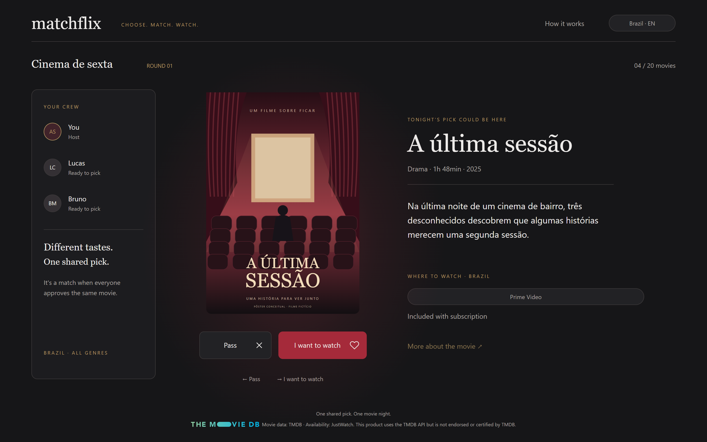
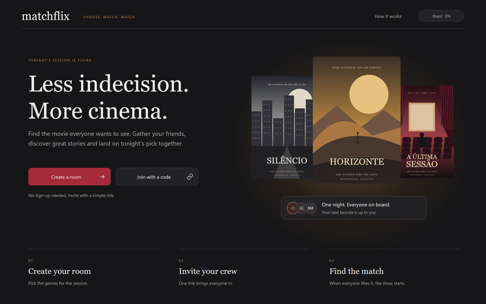

# Matchflix

[Português](README.md) · **English**

**Group movie picking, by swipe.** Everyone votes on their own phone; when **everyone** approves the same movie, it's a match.

[](https://github.com/arthursobral/Matchflix/actions/workflows/ci.yml)
**Demo:** [matchflix-dusky.vercel.app](https://matchflix-dusky.vercel.app) — open it in a normal window and a private one (or on two devices) to see a match happen. Switch to English with the "Brasil · PT" button in the header.

<p>
  
</p>

<table>
  <tr>
    <td></td>
    <td width="24%"></td>
  </tr>
  <tr>
    <td></td>
    <td width="24%"></td>
  </tr>
</table>

> The screenshots use demo mode (fictional movies with original poster art, kept in Portuguese since the titles are drawn on the posters). In a real room, the catalog, posters and "where to watch" come from TMDB, in the chosen language.

## How it works

1. **Create a room** — name, country and genres. No sign-up: everyone joins with an anonymous session and a nickname.
2. **Invite your crew** — by link or room code (`MFX824`). People who join show up live for everyone.
3. **Vote** — 20 movies per round, by swiping the poster, with the buttons or with the arrow keys. Votes are secret.
4. **It's a match** when everyone approves the same movie: the screen appears for everyone at the same time, with where to watch in that country. If nobody agrees, the end of the round shows the most approved and the host starts another one (optionally changing the genres), never repeating a movie.

## Technical highlights

- **The result is decided on the server, never in the browser.** Every write goes through Postgres functions (`security definer`); tables only have read policies (RLS). The match is computed in `cast_vote` under a row lock: without it, the last two "yes" votes for a movie arriving together would each see n−1 and nobody would declare the match. A test fires 30 votes at once — with the lock removed, it fails 5 out of 5 times.
- **Isolated rooms.** Someone in one room can't read or change anything in another (rooms, participants, rounds, votes, matches), and votes stay private even inside the room — all covered by tests against the real database.
- **Realtime that doesn't trust realtime.** Supabase Realtime events have no delivery guarantee; the app reconciles on reconnect and re-checks state every 10s. Tested by dropping the WebSocket, and also by discarding only the events while the connection stays up.
- **Halo in the poster's color.** The dominant color is extracted in the browser (24×24 canvas, grouped by hue and weighted by chroma so black, white and gray don't wash it out), with saturation and lightness clamped so it never fights the brand.
- **Network failures with clear messages.** TMDB being down doesn't turn into "movie not found"; stuck calls give up instead of freezing the screen; the CAPTCHA has a time limit and a "try again" that works. Each case has a test that simulates the failure.
- **Accessible.** Zero axe-core violations (WCAG 2.1 A/AA) on every screen, desktop and mobile; keyboard voting; focus trapped in the modal; messages announced to screen readers; reduced motion respected.
- **Two languages.** Portuguese and English, chosen in the header and stored in a cookie read on the server, so pages arrive in the right language without flashing. Errors raised inside the libraries are typed and translated at render time.
- **No leftover data.** Rooms expire after 1h without activity and are deleted 24h later, with everything in them (`pg_cron`).
- **Anonymous sign-in protected by a CAPTCHA** (Cloudflare Turnstile), with no friction for humans.

## Stack

| | |
|---|---|
| App | Next.js 16 (App Router), React 19, TypeScript, CSS Modules — no UI library |
| Backend | Supabase: Postgres with RLS and `security definer` functions, Realtime, anonymous auth, `pg_cron` |
| Catalog | TMDB (movies, posters, where to watch via JustWatch), server-side only |
| Protection | Cloudflare Turnstile |
| Hosting | Vercel |
| Tests | Playwright (e2e), axe-core, SQL script; CI on GitHub Actions |

## Tests

**102 end-to-end tests** (Playwright) in 12 files, against a real Supabase (local, in Docker) and the real TMDB: full flow, consensus, concurrent votes, room isolation, network failures, the English version, layout positions checked against the approved design (3px tolerance), accessibility. Plus a SQL script (`supabase/tests/`) for data retention.

The tests for the most important fixes went through **mutation checks**: the fix is undone on purpose and the test must fail — proving it catches the bug instead of just passing.

CI runs types, lint, build and the tests on every PR (the ones that need Supabase are skipped there).

## Running locally

Requirements: Node 24, a Supabase project (the free plan is enough) and a TMDB API key.

```bash
npm ci
cp .env.example .env.local   # fill in the variables (see the comments in the file)
npm run dev
```

In Supabase: enable anonymous sign-ins (Authentication → Sign In / Providers) and run the files in `supabase/migrations/`, in order, in the SQL Editor. Without `TMDB_API_KEY`, the app uses the fictional demo movies; without `NEXT_PUBLIC_TURNSTILE_SITE_KEY`, it runs without a CAPTCHA.

**Tests** — against a local Supabase in Docker: `npx supabase init` (once; in `supabase/config.toml`, set `enable_anonymous_sign_ins = true`) and `npx supabase start`, which applies the migrations and prints the local anon key.

```bash
NEXT_PUBLIC_SUPABASE_URL=http://127.0.0.1:54321 NEXT_PUBLIC_SUPABASE_ANON_KEY=<local anon key> NEXT_PUBLIC_TURNSTILE_SITE_KEY= npx playwright test
```

## Structure

```
app/                 screens (App Router) and /api routes (catalog, health)
components/          shared components (button, poster, modal, where to watch…)
lib/                 rooms and votes (Supabase), catalog (TMDB), poster color, CAPTCHA
messages/            every UI string (pt-BR and en)
supabase/migrations/ database schema, RLS and functions
e2e/                 Playwright tests
```

## Credits

Movie data: [TMDB](https://www.themoviedb.org). Availability: JustWatch, via TMDB. This product uses the TMDB API but is not endorsed or certified by TMDB.

A portfolio project by **Arthur Sobral**.
