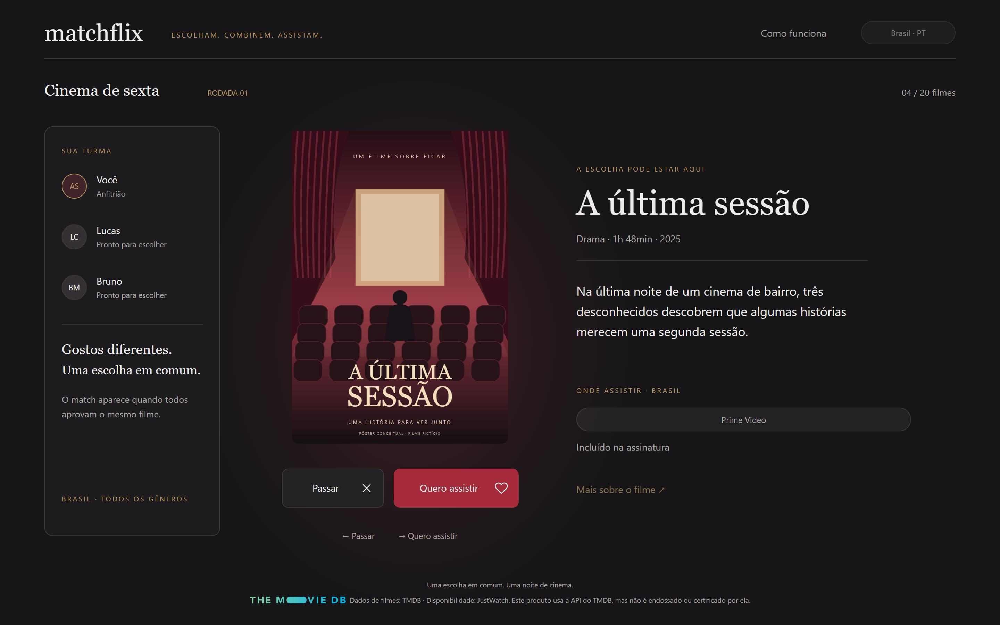
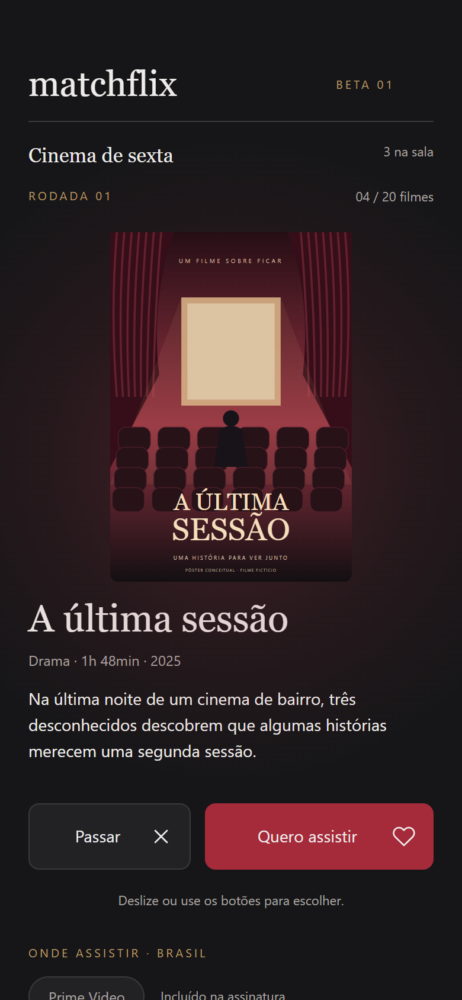
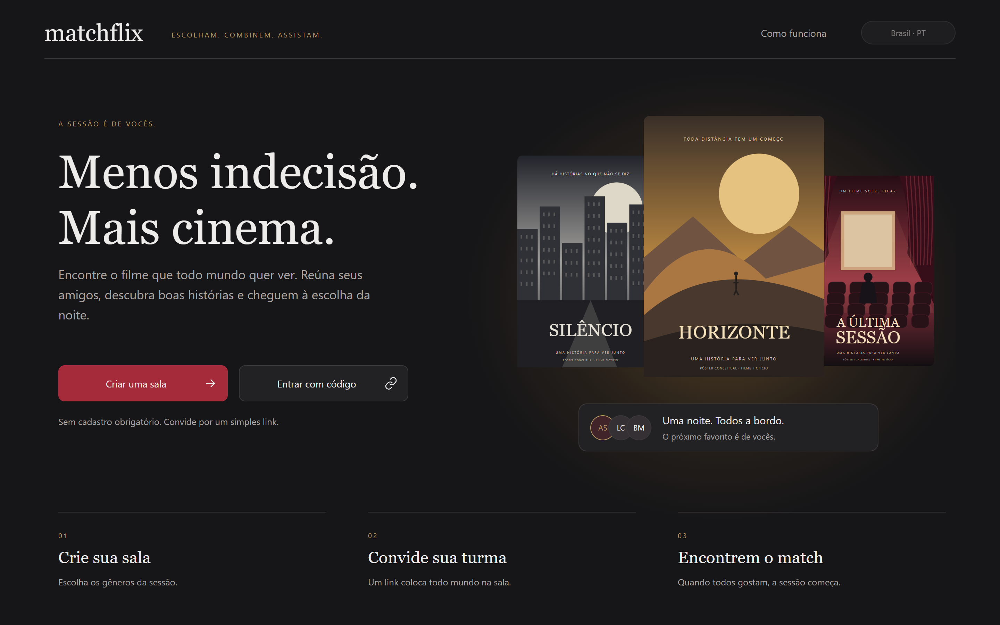
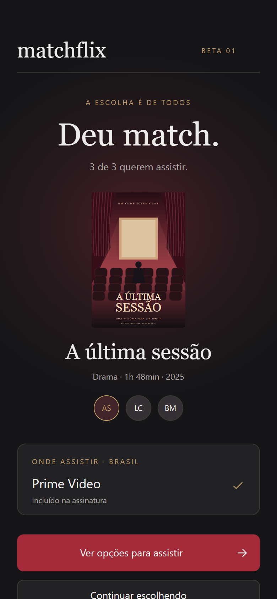

# Matchflix

**Português** · [English](README.en.md)

**Escolha de filme em grupo, por swipe.** Cada pessoa vota no próprio celular; quando **todo mundo** aprova o mesmo filme, dá match.

[](https://github.com/arthursobral/Matchflix/actions/workflows/ci.yml)
**Demo:** [matchflix-dusky.vercel.app](https://matchflix-dusky.vercel.app) — abra numa janela normal e numa anônima (ou em dois aparelhos) para ver o match acontecer.

<p>
  
</p>

<table>
  <tr>
    <td></td>
    <td width="24%"></td>
  </tr>
  <tr>
    <td></td>
    <td width="24%"></td>
  </tr>
</table>

> O site tem versão em português e em inglês (seletor "Brasil · PT" no cabeçalho).
>
> As capturas usam o modo de demonstração (pôsteres fictícios, arte própria). Na sala de verdade, o catálogo, os pôsteres e o "onde assistir" vêm do TMDB.

## Como funciona

1. **Crie uma sala** — nome, país e gêneros. Sem cadastro: cada pessoa entra com uma sessão anônima e um apelido.
2. **Convide a turma** — por link ou pelo código (`MFX824`). Quem entra aparece ao vivo para todos.
3. **Votem** — 20 filmes por rodada, arrastando o pôster, pelos botões ou pelas setas do teclado. Os votos são secretos.
4. **Deu match** quando todos aprovam o mesmo filme: a tela aparece para todo mundo ao mesmo tempo, com onde assistir no país. Se ninguém concordar, o fim da rodada mostra os mais aprovados e o anfitrião abre outra (podendo trocar os gêneros), sem repetir filme.

## Destaques técnicos

- **O resultado é decidido no servidor, nunca no navegador.** Toda escrita passa por funções Postgres (`security definer`); as tabelas só têm políticas de leitura (RLS). O match é calculado em `cast_vote`, com trava de linha: sem ela, os dois últimos "sim" de um filme chegando juntos se veriam como n−1 e ninguém declararia o match. Há um teste que dispara 30 votos ao mesmo tempo — e, com a trava removida, ele falha 5 de 5 vezes.
- **Salas isoladas.** Quem está numa sala não lê nem altera nada de outra (salas, participantes, rodadas, votos, matches), e votos são privados até dentro da própria sala — tudo coberto por teste contra o banco de verdade.
- **Tempo real que não confia no tempo real.** Os avisos do Supabase Realtime não têm garantia de entrega; o app reconcilia ao reconectar e confere o estado a cada 10s. Testado derrubando o WebSocket e também descartando só os avisos com a conexão de pé.
- **Halo na cor do pôster.** A cor dominante é extraída no navegador (canvas 24×24, agrupada por matiz e ponderada pela intensidade da cor, para que preto, branco e cinza não diluam o resultado), com saturação e brilho limitados para não brigar com a marca.
- **Falhas de rede com mensagem clara.** TMDB fora do ar não vira "filme não encontrado"; chamadas travadas desistem em vez de prender a tela; o CAPTCHA tem limite de tempo e "tente de novo" que funciona. Cada caso tem teste que simula a falha.
- **Acessível.** Zero violações do axe-core (WCAG 2.1 A/AA) em todas as telas, no desktop e no celular; voto por teclado; foco preso no modal; mensagens anunciadas para leitor de tela; movimento reduzido respeitado.
- **Sem lixo acumulado.** Salas expiram após 1h sem atividade e são apagadas 24h depois, com tudo delas (`pg_cron`).
- **Login anônimo protegido por CAPTCHA** (Cloudflare Turnstile), sem atrito para quem é humano.

## Stack

| | |
|---|---|
| App | Next.js 16 (App Router), React 19, TypeScript, CSS Modules — sem biblioteca de UI |
| Backend | Supabase: Postgres com RLS e funções `security definer`, Realtime, login anônimo, `pg_cron` |
| Catálogo | TMDB (filmes, pôsteres, onde assistir via JustWatch), só no servidor |
| Proteção | Cloudflare Turnstile |
| Hospedagem | Vercel |
| Testes | Playwright (e2e), axe-core, roteiro SQL; CI no GitHub Actions |

## Testes

**102 testes end-to-end** (Playwright) em 12 arquivos, contra um Supabase de verdade (local, em Docker) e o TMDB real: fluxo completo, consenso, votos concorrentes, isolamento entre salas, falhas de rede, versão em inglês, posições do layout conferidas contra o design aprovado (tolerância de 3px), acessibilidade. Mais um roteiro SQL (`supabase/tests/`) para a retenção de dados.

Os testes das correções mais importantes passaram por **checagem de mutação**: o código corrigido é desfeito de propósito e o teste precisa falhar — para provar que ele pega o bug, e não apenas passa.

O CI roda tipos, lint, build e os testes a cada PR (os que dependem do Supabase são pulados lá).

## Rodando localmente

Requisitos: Node 24, um projeto Supabase (o plano gratuito basta) e uma chave da API do TMDB.

```bash
npm ci
cp .env.example .env.local   # preencha as variáveis (veja os comentários no arquivo)
npm run dev
```

No Supabase: habilite o login anônimo (Authentication → Sign In / Providers) e rode, em ordem, os arquivos de `supabase/migrations/` no SQL Editor. Sem `TMDB_API_KEY`, o app usa os filmes fictícios da demonstração; sem `NEXT_PUBLIC_TURNSTILE_SITE_KEY`, funciona sem CAPTCHA.

**Testes** — contra um Supabase local, em Docker: `npx supabase init` (uma vez; em `supabase/config.toml`, ligue `enable_anonymous_sign_ins = true`) e `npx supabase start`, que aplica as migrações e mostra a chave anon local.

```bash
NEXT_PUBLIC_SUPABASE_URL=http://127.0.0.1:54321 NEXT_PUBLIC_SUPABASE_ANON_KEY=<anon local> NEXT_PUBLIC_TURNSTILE_SITE_KEY= npx playwright test
```

## Estrutura

```
app/                 telas (App Router) e rotas /api (catálogo, saúde)
components/          componentes compartilhados (botão, pôster, modal, onde assistir…)
lib/                 salas e votos (Supabase), catálogo (TMDB), cor do pôster, CAPTCHA
messages/            todos os textos da interface (pt-BR e en)
supabase/migrations/ esquema, RLS e funções do banco
e2e/                 testes Playwright
```

## Créditos

Dados de filmes: [TMDB](https://www.themoviedb.org). Disponibilidade: JustWatch, via TMDB. Este produto usa a API do TMDB, mas não é endossado ou certificado por ela.

Projeto de portfólio de **Arthur Sobral**.
